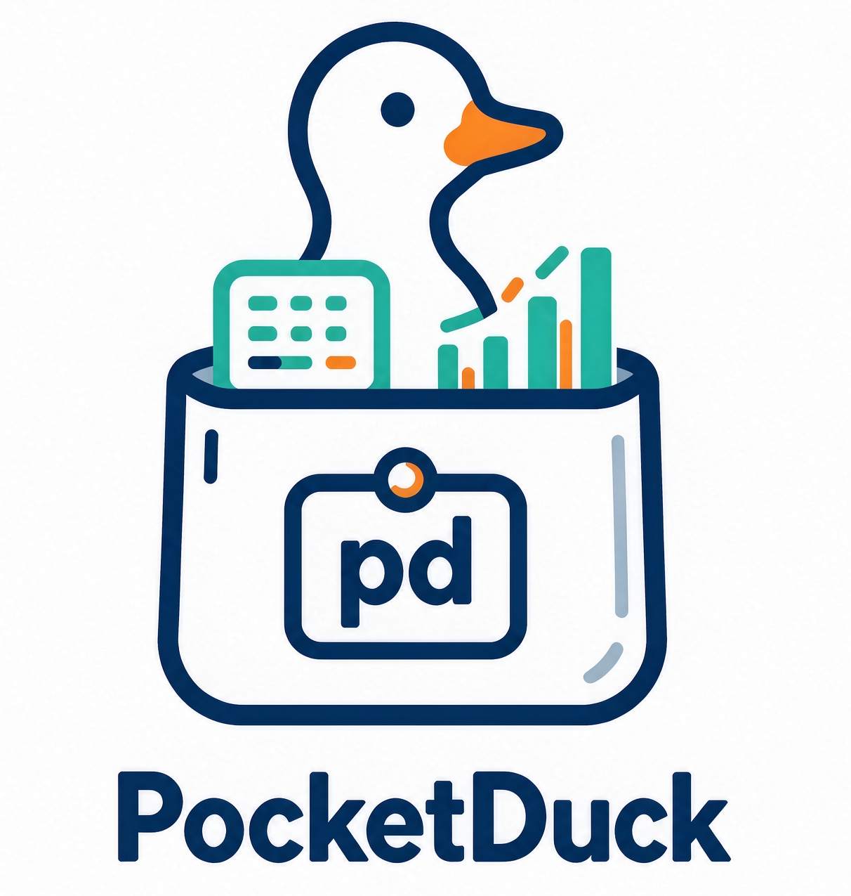

<div align="center">

<!-- Place your logo at docs/assets/logo.png -->
<!--  -->

# PocketDuck

**One binary. PocketBase backend + DuckDB analytics.**

[中文文档](README.zh-CN.md)

</div>

> Built on [PocketBase](https://pocketbase.io) and [DuckDB](https://duckdb.org).
> Unofficial community project, not affiliated with or endorsed by either.

PocketDuck is a single-binary backend for small analytics apps:

- **PocketBase** — auth, collections, files, realtime, admin UI, static frontend (`pb_public/`)
- **DuckDB** — read-only SQL analytics over local/remote Parquet, CSV and SQLite files, with cross-source joins

One `POST /api/analyze` endpoint. No drivers to install: Parquet/CSV are built in, SQLite reads via `sqlite_scan()`.

```sql
-- one query joining a 3M-row Parquet fact table with a SQLite dimension table
SELECT z.Borough, extract(hour FROM t.tpep_pickup_datetime) AS pickup_hour, avg(t.fare_amount)
FROM read_parquet('data/yellow_tripdata_2025-01.parquet') t
JOIN sqlite_scan('testdata/zones.sqlite', 'zones') z ON t.PULocationID = z.LocationID
GROUP BY 1, 2
```

## Quickstart

**Prerequisites**: [Go 1.22+](https://go.dev/dl/) and a C compiler (DuckDB is linked via cgo):

- **Windows**: [WinLibs UCRT](https://github.com/brechtsanders/winlibs_mingw/releases) (GCC with UCRT runtime — plain MSVCRT toolchains fail to link DuckDB)
- **Linux**: `apt install gcc` (or your distro equivalent)

```bash
git clone <repo-url> PocketDuck && cd PocketDuck
set CGO_ENABLED=1        # Windows (cmd); Linux/macOS: export CGO_ENABLED=1
go build -o pduck.exe .  # Linux: go build -o pduck .

# start the server
./pduck.exe serve --http=127.0.0.1:8090
```

Create an admin account (another terminal):

```bash
./pduck.exe superuser upsert admin@example.com yourpassword
```

Get a token:

```bash
curl -s http://127.0.0.1:8090/api/collections/_superusers/auth-with-password \
  -H "Content-Type: application/json" \
  -d '{"identity":"admin@example.com","password":"yourpassword"}'
# → {"token":"...","record":{...}}
```

Fetch the demo dataset (NYC Taxi Jan 2025, ~59 MB) and run the cross-source query:

```bash
mkdir -p data && curl -L -o data/yellow_tripdata_2025-01.parquet \
  https://d37ci6vzurychx.cloudfront.net/trip-data/yellow_tripdata_2025-01.parquet
```

```bash
curl -s http://127.0.0.1:8090/api/analyze \
  -H "Authorization: <TOKEN>" -H "Content-Type: application/json" \
  -d '{"sql":"SELECT z.Borough, CAST(extract(hour FROM t.tpep_pickup_datetime) AS INT) AS pickup_hour, round(avg(t.fare_amount),2) AS avg_fare FROM read_parquet('"'"'data/yellow_tripdata_2025-01.parquet'"'"') t JOIN sqlite_scan('"'"'testdata/zones.sqlite'"'"','"'"'zones'"'"') z ON t.PULocationID = z.LocationID WHERE z.Borough != '"'"'Unknown'"'"' GROUP BY 1,2 ORDER BY 1,2","timeout_ms":180000}'
```

Response:

```json
{"columns":["Borough","pickup_hour","avg_fare"],"rows":[["Bronx",0,19.32],["Bronx",1,10.21],...],"row_count":166,"elapsed_ms":124,"truncated":false}
```

## The API

`POST /api/analyze` — authenticated (PocketBase token), read-only, hard-capped:

| Field | In | Notes |
|---|---|---|
| `sql` | body | required; only SELECT queries — the DuckDB file is opened `access_mode=read_only` |
| `params` | body | optional positional SQL parameters |
| `timeout_ms` | body | default 30000, max 300000; the query is interrupted server-side |

Response: `{columns, rows, row_count, elapsed_ms, truncated}`. Rows are capped at 10,000 (`truncated: true` beyond).

Verification is falsifiable: the demo query's expected output was frozen from an independent DuckDB CLI run ([`testdata/expected/`](testdata/expected/)) and compared row-by-row in CI-style checks — 166 rows exact match, P95 ≈ 140 ms on a laptop.

## Routes

| Roadmap | Status |
|---|---|
| Read-only `/api/analyze` over Parquet/CSV/SQLite | ✅ v0 |
| Write-side pipeline (SQL file → cron → Parquet/PG) | planned |
| PostgreSQL / MySQL sources | planned |
| SQL console page, xlsx export | far future |

## License

MIT. PocketBase and DuckDB are separate MIT-licensed projects; their names are used only to describe what this project builds on.
